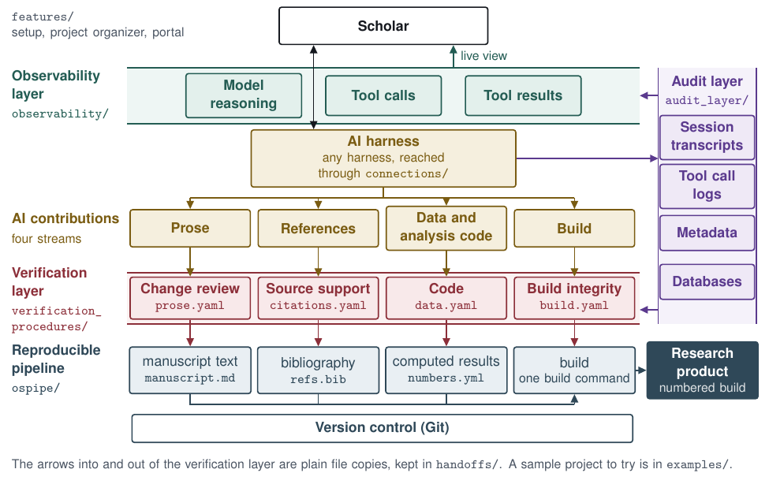

# An AI-Enhanced Workflow for Verifiable Social Science

This repository is the research artifact of the workflow, a prototype that builds research products from plain-text files, records and tags the AI work behind them, and checks each AI contribution before the scholar approves or holds it.



**See it run on a real project.** [verifiable-proposal-demo](https://github.com/mro0001/verifiable-proposal-demo) holds this workflow's reports on its own proposal and technical appendix.

## Each layer is a folder

| On the map | Folder | What it does |
|---|---|---|
| Scholar | [`features/`](features/README.md) | Sets up the workflow and each project, organizes a project, builds the learning portal, and assembles a verification repository to check and publish |
| Observability layer | [`observability/`](observability/README.md) | Shows AI work as it happens |
| AI harness | [`connections/`](connections/README.md) | Connects the scholar's own harness, model, and software through wrappers, MCP servers, and adapters |
| Audit layer | [`audit_layer/`](audit_layer/README.md) | Records and tags every AI session and tool call, and holds the databases |
| Verification layer | [`verification_procedures/`](verification_procedures/README.md) | Checks the AI contributions in each stream and writes a report for the scholar |
| Reproducible pipeline | [`ospipe/`](ospipe/README.md) | Builds each research product from plain text, filling every number from one numbers file |
| Arrows into and out of the verification layer | [`handoffs/`](handoffs/README.md) | Copies files from one layer to another |
| Not on the map | [`examples/`](examples/README.md) | A sample project, and the test story every layer's tests use |

The layers share no code. Only files and command lines cross from one layer to another.

## Each column is a stream

| Stream | Check | What a program checks | What a model does |
|---|---|---|---|
| [Prose](guide/streams/prose.md) | Change review | Each AI change to the text has a recorded reason, and changes to numbers, citations, quotes, negations, or a claim's strength are flagged | Nothing |
| [References](guide/streams/references.md) | Source support | Each cited work exists, and each quote is word for word in its source | Locates the passage a sentence draws on |
| [Data and analysis code](guide/streams/data.md) | Code | Every number the text cites comes out the same in a rerun from the raw data | Nothing. In the three phase reports, finds the sentences that describe a phase and the lines that carry it out |
| [Build](guide/streams/build.md) | Build integrity | Every build comes from the build command, and no AI wrote into a build | Nothing |

A model never gives a verdict. Programs check, and the scholar approves or holds each item.

## Try it in a minute

Nothing here uses the network or calls a model, apart from installing the packages.

```
python3 -m pip install -r requirements.txt
cd verification_procedures
VG_OFFLINE=1 python3 vg.py run graphs/citations.yaml --run runs/try_citations --inputs fixtures/citations/seeded --judge recorded:fixtures/citations/seeded/recorded_judge.json
python3 vg.py score --run runs/try_citations --truth fixtures/citations/seeded/truth.yaml
```

The last command prints `{"faults": 13, "recall": 1.0, "missed": []} extras=0`. The references check caught all 13 faults planted in a synthetic manuscript, and its report is `runs/try_citations/files/report.md`. Each stream's page gives the same two commands for its own check.

## Full reference

### Other files

| Path | What it is |
|---|---|
| `templates/notes/` | The notes layer template, ten areas with boundary rules |
| `design/` | The verification procedures design of October 9, 2026 and the file protocol of September 18, 2026, which the appendix cites, and the authors' design notes of October 8, 2026, on the four verification streams, which the graphs cite by date. `design/README.md` says what each file is |
| `MANUSCRIPT_WORKFLOW.md` | The design spec the procedural graphs and knowledge base entries cite. Its dated status sections are kept as history |
| `verification_procedures/live_runs_2026-10-08/` | The records of the seven live model runs of October 8, 2026 |

### Requirements

The commands need Python 3.9 or later with the packages in `requirements.txt` (PyYAML, python-docx 1.2 or later, and pytest), installed with `pip install -r requirements.txt`. They also need Pandoc 3 and Make on the command path. The stored test builds were made with Pandoc 3.9.0.2. Microsoft Word 16 is needed only for the Word compare script, `verification_procedures/review/word_compare.applescript`, which takes full paths.

### Run the prototype offline

None of these commands uses the network or calls an AI model, apart from installing the packages. The first block installs the packages and runs the eight test suites from the repository's folder. Each suite runs in its own folder, since test file names repeat across folders.

```
python3 -m venv ../vg-venv
. ../vg-venv/bin/activate
python3 -m pip install -r requirements.txt
(cd ospipe && python3 -m pytest -q)
(cd verification_procedures && python3 -m pytest -q)
python3 -m pytest -q audit_layer
python3 -m pytest -q examples/test_story
python3 -m pytest -q handoffs/tests
python3 -m pytest -q observability/tests
python3 -m pytest -q connections/tests
python3 -m pytest -q features/tests
```

The second block builds the two research products of the sample project in `examples/sample_project/`, a one-page test manuscript and a four-slide deck. Its analysis script computes the results both products cite, and the build fills them in from the project's numbers file. The data handoff then gathers the project's files for the data procedure, whose final-numbers report lists each number with the output and the script that produce it and checks it against a rerun of the analysis. The data phase handoff gathers the pipeline, its script, and the text of the latest manuscript build for the data analysis report, which lists the steps the script marks, then each step with its exact code, then each sentence of the text that describes the analysis with where the script carries it out. Recorded answers stand in for that report's one model step, which only finds the sentences and the lines.

```
cd examples/sample_project
python3 s1_results.py
PYTHONPATH=../../ospipe python3 -m ospipe build --manuscript manuscript.md --manifest numbers.yml --tables-dir . --bib refs.bib --builds-dir builds/manuscript --purpose "sample manuscript"
PYTHONPATH=../../ospipe python3 -m ospipe build --manuscript slides.md --manifest numbers.yml --tables-dir . --to revealjs --builds-dir builds/slides --purpose "sample slides"
cd ../../verification_procedures
python3 ../handoffs/project_to_data.py --project ../examples/sample_project --to runs/demo_sample_inputs
python3 vg.py run graphs/data.yaml --run runs/demo_sample --inputs runs/demo_sample_inputs
python3 ../handoffs/project_to_data_phases.py --project ../examples/sample_project --to runs/demo_sample_phases
python3 vg.py run graphs/data_analysis.yaml --run runs/demo_sample_analysis --inputs runs/demo_sample_phases --judge recorded:../examples/sample_project/recorded_phases.json
```

The third block runs the references procedure (`citations`) on its seeded test files from `verification_procedures/`, then replays and scores the run. Its inputs are the final build's filled-in text as `draft.md`, the audit layer's citation provenance record as `citation_provenance.yaml`, the reference list `refs.yaml`, the metadata cache `metadata_cache.json`, and the source texts `source_*.txt`. These are the files `handoffs/project_to_references.py` gathers from a project. The one model step only locates a passage in a source, so the block names one set of recorded answers and no second checker.

```
VG_OFFLINE=1 python3 vg.py run graphs/citations.yaml --run runs/demo_citations --inputs fixtures/citations/seeded --judge recorded:fixtures/citations/seeded/recorded_judge.json
python3 vg.py verify --run runs/demo_citations
python3 vg.py score --run runs/demo_citations --truth fixtures/citations/seeded/truth.yaml
```

The fourth block runs the prose procedure, the data procedure, the three data phase reports, and the build procedure on their seeded test files and scores each run. The prose report lists each change between the scholar's last draft and the final text and shows each of the AI's changes with the reason the record gives. Neither the prose report nor the final-numbers report asks a model. The three phase reports read one set of seeded test files, whose planted faults are in the cleaning report, so that run is the one scored.

```
python3 vg.py run graphs/prose.yaml --run runs/demo_prose --inputs fixtures/prose/seeded
python3 vg.py score --run runs/demo_prose --truth fixtures/prose/seeded/truth.yaml
python3 vg.py run graphs/data.yaml --run runs/demo_data --inputs fixtures/data/seeded
python3 vg.py score --run runs/demo_data --truth fixtures/data/seeded/truth.yaml
python3 vg.py run graphs/data_collection.yaml --run runs/demo_data_collection --inputs fixtures/data_phases/seeded --judge recorded:fixtures/data_phases/seeded/recorded_judge.json
python3 vg.py run graphs/data_cleaning.yaml --run runs/demo_data_cleaning --inputs fixtures/data_phases/seeded --judge recorded:fixtures/data_phases/seeded/recorded_judge.json
python3 vg.py run graphs/data_analysis.yaml --run runs/demo_data_analysis --inputs fixtures/data_phases/seeded --judge recorded:fixtures/data_phases/seeded/recorded_judge.json
python3 vg.py score --run runs/demo_data_cleaning --truth fixtures/data_phases/seeded/truth.yaml
python3 vg.py run graphs/build.yaml --run runs/demo_build --inputs fixtures/build/seeded
python3 vg.py score --run runs/demo_build --truth fixtures/build/seeded/truth.yaml
```

Three settings change how the references procedure looks up a DOI that its cache does not hold.

- `VG_OFFLINE=1` counts such a DOI as not found instead of looking it up on Crossref or DataCite.
- `VG_CROSSREF_URL` sets the address of the Crossref lookup, `https://api.crossref.org/works/` when unset.
- `VG_DATACITE_URL` sets the address of the DataCite lookup, made for a DOI Crossref has no record of, `https://api.datacite.org/dois/` when unset.

Section A4 of the technical appendix gives the expected result of each block.

### Use it on your own project

To use the workflow on your own work, run `python3 -m features setup system` once from the repository's folder, then `python3 -m features setup project` for each project. `features/setup/GUIDE.md` gives the answers each command reads, where each one writes, and what setup never does.

When the reports are done, `python3 -m features publish plan DIR`, then `python3 -m features publish build DIR --out OUT`, assembles a verification repository like the demo's, `python3 vg.py run graphs/ops_publish.yaml` from `verification_procedures/` checks it before it goes public, and `features/publish/GUIDE.md` gives the answers file and what publishing never does.

### Status

Every layer is built and tested. At this commit the eight suites pass with the counts below. One more features test, which runs git itself, is skipped on a machine where git does not run from Python.

| Suite | Tests |
|---|---|
| `ospipe` | 443 |
| `verification_procedures` | 954 |
| `audit_layer` | 1,337 |
| `examples/test_story` | 40 |
| `handoffs/tests` | 148 |
| `observability/tests` | 338 |
| `connections/tests` | 559 |
| `features/tests` | 876 |
| Total | 4,695 |

Nothing has yet been run live on this build. The records of the seven live model runs of October 8, 2026, on an earlier build, are in `verification_procedures/live_runs_2026-10-08/`.

### License

The license of each file follows its type.

- The MIT License in `LICENSE` covers the code, the procedure definitions the runtime executes (graphs, contracts, schemas, `verification_procedures/registry.yaml`, and the implementations with their prompts), `features/portal/portal.yaml`, and the templates copied into a scholar's project (`templates/notes/` and `features/setup/project_template/`).
- The Creative Commons Attribution 4.0 International License in `LICENSE-CC-BY-4.0.txt` covers the documentation, the knowledge base corpus, and the test materials, among them the fixtures, the examples' data and text, the truth files, the recorded answers, and the live run records.
