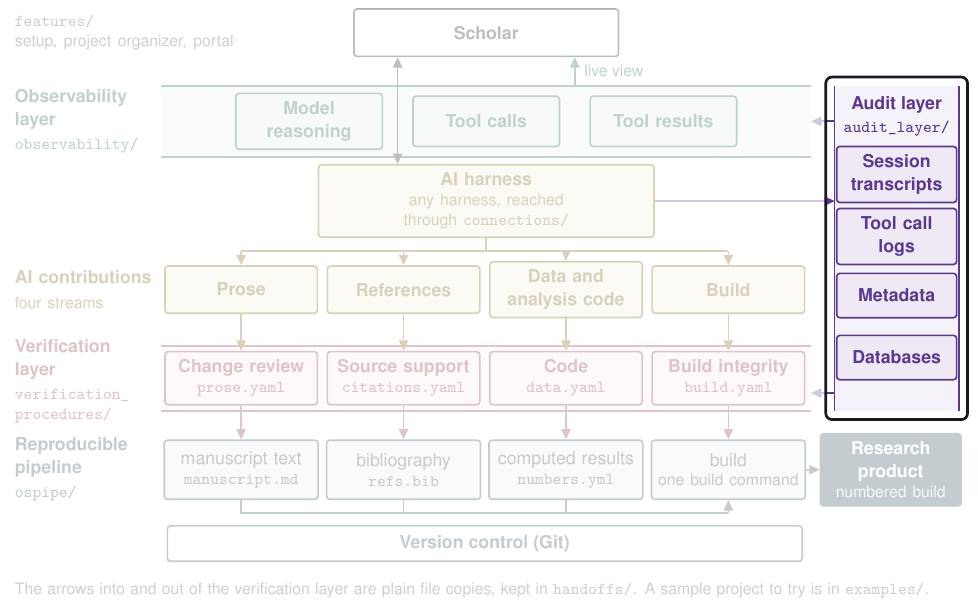

# The audit layer (`audit_layer/`)

The audit layer captures, records, stores, and tags every AI session transcript and tool call. It also holds the databases, including the knowledge base where the procedural graphs are kept, and writes a public, searchable index of a project's AI sessions that names the AI contributions each session made to the final reports while the transcripts stay private. Every check in the verification layer reads what this layer writes out.

| Read | For |
|---|---|
| `python3 -m audit_layer --help` | The commands: `capture`, `sweep`, `tag`, `write-out`, and the rest |
| [`hooks/INSTALL.md`](hooks/INSTALL.md) | Starting the capture by hook and on a schedule |
| [`kb/CONTRACT.md`](kb/CONTRACT.md) | The knowledge base and its entries, in [`kb/corpus/`](kb/corpus/) |

Run its tests with `python3 -m pytest -q audit_layer` from the repository's folder.

[Back to the map](../README.md)
