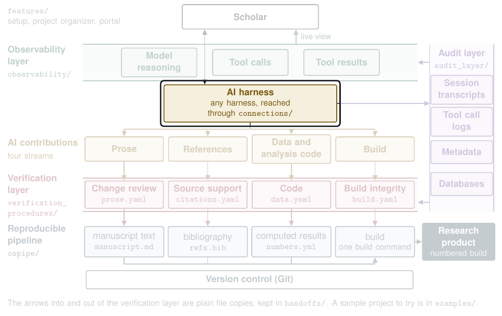

# Connections

The connectors reach the scholar's own harness, model, and software without replacing them (appendix A2.2, Figure A2). They sit outside any single project, so one setup serves every project. The repository installs nothing. Every step below is done by hand, and each says how to undo it.



These connectors are how the AI harness, the AI model, and the scholar's other software reach every layer of the map. [Back to the map](../README.md).

Run every command from the repository folder, or set `PYTHONPATH` to it, since `connections` is a folder of this repository and is not installed. The `python3` must be one that has PyYAML. Python 3.9 is enough.

## The connectors and their commands

| Connector | Command | What it does |
|---|---|---|
| Wrapper | `python3 -m connections wrap -- PROGRAM [ARGS...]` | Runs the program as it would run anyway and logs the call, plus a `wrote` event for each file the call made or changed under its working folder. |
| Knowledge base server, `workflow-kb` | `python3 -m connections serve kb --index FILE` | Serves the knowledge base to an MCP client, with five tools. Each call runs the `mcp_kb` graph through `vg.py run` on the `kb-index` export named, read fresh on each call, and keeps the run folder under `kb_runs/` in the connections home. |
| Audit store server, `workflow-audit` | `python3 -m connections serve audit [--home DIR]` | Serves the audit store's current rows, read only. It never serves a transcript. |
| Events tool, `workflow-events` | `python3 -m connections serve events` | Gives an MCP client one tool, `record_event`, which logs an event from outside software for the server's working folder. |
| Provider setting | `python3 -m connections provider show` | Prints the provider file, its `base_url` and `model`, its `second_model`, `token_limit`, and `token_limit_field` when they are set, and whether the key is set. It never prints the key. |
| Provider setting, written | `python3 -m connections provider set --base-url URL --model NAME [--second-model NAME] [--token-limit N --token-limit-field FIELD] [--home DIR]` | Writes `provider.yaml` in the connections home, replacing an earlier one, and never a key. System setup runs it with the scholar's answers. |
| Citation manager adapter | `python3 -m connections adapt citations --out DIR --export FILE` | Turns a CSL JSON or BibTeX export into the references stream's `refs.yaml`. |
| Word adapter | `python3 -m connections adapt word --out DIR --docx FILE --ai-author NAME [--annotations FILE] [--builds-dir DIR --baseline-version vNNN]` | Turns a reviewed Word document into the prose stream's input files. |
| R adapter | `python3 -m connections adapt r --out DIR --scripts FILE... [--helpers FILE...]` | Turns R scripts with their header blocks into the data stream's `pipeline.yaml`. |
| Quarto adapter | `python3 -m connections adapt quarto --out DIR --docs FILE...` | Turns Quarto documents into the data stream's `pipeline.yaml` and `params.yaml`. |
| AI-edit and end-of-turn triggers | `python3 -m connections trigger hook` | Answers one Claude Code hook. An AI edit marks the matching procedures due, and the end of the turn starts each due procedure once, in the background. |
| Make trigger | `python3 -m connections trigger make --project DIR [--source FILE] [--numbers FILE]` | Before a build, starts each stream whose results file no longer covers the source text or the numbers file, and never fails the make. |

Every adapter reads only the files named on its command line, writes only its input files and `adapter_record.json` into `--out`, and refuses to replace a file already there. `python3 -m connections <command> --help` prints each command's options.

## The connections home

The connectors keep their settings and their events in one folder for each scholar, the connections home. It is the folder `CONNECTIONS_HOME` names, else `~/.workflow_connections`. It holds these.

- `provider.yaml`, the provider setting.
- `triggers.yaml`, the start command for each procedure.
- `events/`, the event files.
- `triggers/due/`, the procedures an AI edit marked due, one file for each project folder, and `triggers/logs/`, the output of each procedure the end of a turn started.
- `kb_runs/`, one run folder for each knowledge base call.

## Where events land

Every event a connector writes is one JSON line in `events/<YYYY-MM-DD>_<key>.jsonl` in the connections home. The key is the first 12 hex characters of the sha256 of the real path of the working folder. So there is one file for each day and folder. A line holds the event schema's fields, with `harness` set to `wrappers` and `harness_session_id` set to the file name without `.jsonl`, plus `at` (the time), `cwd` (the folder), and `program`. The wrappers, the events tool, and the triggers write events. Each procedure a trigger starts is logged as a `ran` action event with program `trigger`.

The connectors read `excluded_folders` from the audit layer's `settings.yaml`. In a listed folder, or a folder inside one, they record nothing and start nothing. They also record and start nothing at all until that file exists.

## How capture reads them

The audit layer stores each event file as one session of the harness `wrappers`, with the events as written and the file kept unchanged as its transcript. The sweep finds the files in the connections home's `events/` folder.

```sh
python3 -m audit_layer sweep                       # every harness, the wrappers included
python3 -m audit_layer sweep --harness wrappers    # the event files only
python3 -m audit_layer capture --harness wrappers ~/.workflow_connections/events/2026-10-29_0123456789ab.jsonl
```

A file that gains lines is stored again, as a new session row that supersedes the old one. Wrapper sessions are not AI sessions, so the model pass, the working-file snapshots, and the written-out session writes, rationales, and citation log skip them. The live view shows the events once capture has stored them.

## Install, step by step

Set up the audit home first, as `audit_layer/hooks/INSTALL.md` says (`python3 -m audit_layer init`, then list your excluded folders in its `settings.yaml`). Until that file exists the connectors record and start nothing.

In what follows, replace `/path/to/repo` with the full path of the repository folder.

### 1. The provider setting

Live judgment in `vg.py` and the audit model pass reach the model through this one setting, so no code names a provider. Write `provider.yaml` in the connections home. Any service that offers the chat completions interface fits.

```yaml
base_url: https://models.example.edu/v1
model: example-model
```

If the service needs a key, add this line to your shell profile (`~/.zshrc` or `~/.bashrc`) and open a new shell. With no key set, no key is sent, which suits a local service.

```sh
export WORKFLOW_MODEL_KEY=your-key
```

The setting may also name the output limit of each live reply, `token_limit`, a whole number above 0, and the field the request sends it under, `token_limit_field`, either `max_tokens` or `max_completion_tokens`. Leave both out to keep the request Table A10 records for the runs of October 8, 4,000 tokens under `max_tokens`. A key left out keeps its part of that request. The university's model service takes the limit in this form.

```yaml
base_url: https://models.example.edu/v1
model: example-model
token_limit: 65536
token_limit_field: max_completion_tokens
```

Live judgment in `vg.py` and the audit model pass both send the limit under the named field and under no other, and a live run's manifest records the limit and the field it sent. A limit that is not a whole number above 0, or any other field, stops a live run or a live model pass before any call, naming the file. The setting may also name `request_timeout`, the seconds live judgment and the audit model pass wait for each reply, a whole number above 0, with 300 when it is left out.

The setting may also name `second_model`, another model on the same service that rechecks any verdict that a source does not fully support its sentence.

Instead of writing the file, you can run `python3 -m connections provider set --base-url https://models.example.edu/v1 --model example-model`, adding `--second-model`, `--token-limit`, and `--token-limit-field` as wanted. It never writes a key.

Check it with `python3 -m connections provider show`. A live run then takes `--judge live`, or `--judge live:<model>` for another model on the same service.

To undo, delete `provider.yaml` and the line in your shell profile.

### 2. The three servers

The knowledge base server answers from a `kb-index` export. Write one, and write it again whenever the knowledge base changes.

```sh
cd /path/to/repo && python3 -m audit_layer.kb export --out ~/.workflow_connections/kb_index.json
```

Register the servers with Claude Code at user scope. The name comes before `-e`, since `-e` takes several values.

```sh
claude mcp add -s user workflow-kb -e PYTHONPATH=/path/to/repo -- python3 -m connections serve kb --index /path/to/home/.workflow_connections/kb_index.json
claude mcp add -s user workflow-audit -e PYTHONPATH=/path/to/repo -- python3 -m connections serve audit
claude mcp add -s user workflow-events -e PYTHONPATH=/path/to/repo -- python3 -m connections serve events
```

If your audit home or connections home is not the default, add `-e AUDIT_HOME=...` or `-e CONNECTIONS_HOME=...` the same way. The events tool logs for the folder the client starts it in.

Other MCP clients read the same servers from an `mcpServers` block.

```json
{
  "mcpServers": {
    "workflow-kb": {
      "command": "python3",
      "args": ["-m", "connections", "serve", "kb", "--index", "/path/to/home/.workflow_connections/kb_index.json"],
      "env": {"PYTHONPATH": "/path/to/repo"}
    },
    "workflow-audit": {
      "command": "python3",
      "args": ["-m", "connections", "serve", "audit"],
      "env": {"PYTHONPATH": "/path/to/repo"}
    },
    "workflow-events": {
      "command": "python3",
      "args": ["-m", "connections", "serve", "events"],
      "env": {"PYTHONPATH": "/path/to/repo"}
    }
  }
}
```

To undo, run these, or delete the three entries from the other client's file.

```sh
claude mcp remove -s user workflow-kb
claude mcp remove -s user workflow-audit
claude mcp remove -s user workflow-events
```

### 3. The hooks

The block below holds the audit layer's capture command and the triggers together, so one paste turns on both. Add it to the `hooks` block of `~/.claude/settings.json` to turn the triggers on everywhere. To turn them on one project folder at a time, put the two `connections trigger hook` commands in that project's `.claude/settings.json` instead, and keep the capture commands in `~/.claude/settings.json`. If the file already has a `hooks` block, add these entries to it and never replace it, since that would drop the hooks already there.

```json
{
  "hooks": {
    "PostToolUse": [
      {
        "matcher": "Edit|Write|MultiEdit|NotebookEdit",
        "hooks": [
          {"type": "command", "command": "PYTHONPATH=/path/to/repo python3 -m connections trigger hook"}
        ]
      }
    ],
    "Stop": [
      {
        "hooks": [
          {"type": "command", "command": "python3 /path/to/repo/audit_layer/hooks/claude_code_hook.py"},
          {"type": "command", "command": "PYTHONPATH=/path/to/repo python3 -m connections trigger hook"}
        ]
      }
    ],
    "SubagentStop": [
      {
        "hooks": [
          {"type": "command", "command": "python3 /path/to/repo/audit_layer/hooks/claude_code_hook.py"}
        ]
      }
    ],
    "SessionEnd": [
      {
        "hooks": [
          {"type": "command", "command": "python3 /path/to/repo/audit_layer/hooks/claude_code_hook.py"}
        ]
      }
    ]
  }
}
```

The trigger always exits 0, writes nothing to standard error, and never asks Claude Code to block or continue. At the end of a turn it prints a line such as `Verification started for citations.`, and where that line shows depends on the view. An edited file matches a procedure by its path in the project or its base name, as the registry's `triggers.files` patterns give them. A file reached through a link to a place outside the project matches nothing.

To undo, delete the commands you added and leave the rest of the file as it was.

### 4. The start commands

The triggers start a procedure only through a command you write, one for each procedure id in `verification_procedures/registry.yaml`, in `triggers.yaml` in the connections home. Each `{project}` becomes the project folder, quoted for the shell. A due procedure with no command is named in the status line and not started.

```yaml
start:
  prose: sh ~/workflow_turn/prose.sh {project}
  citations: sh ~/workflow_turn/citations.sh {project}
  data: sh ~/workflow_turn/data.sh {project}
  build: sh ~/workflow_turn/build.sh {project}
```

The end of a turn runs the light working check, and `make verify` below runs the full one, through these same start commands. Make sets `MAKELEVEL` for every command it starts, and the end of a turn does not, so each script tells the two apart by it. Each script runs the capture sweep, the write-out, and the handoffs in `handoffs/`. Started by make, it then does the full run and copies its results file into the project's `verification/` folder, where the build reads it. Otherwise it does `vg.py run <id> --quick`. Here is the references script. It keeps each start's files in a folder of its own.

```sh
#!/bin/sh
set -e
project="$1"
repo=/path/to/repo
refs="$HOME/workflow_refs"   # the references folder you keep, refs.yaml and the rest
work="$HOME/workflow_turn/citations/$(date +%Y%m%d-%H%M%S)"
mkdir -p "$work"
cd "$repo"
python3 -m audit_layer sweep
python3 -m audit_layer write-out citation-provenance --project "$project" --references "$refs/refs.yaml" --out "$work/citation_provenance.yaml"
python3 handoffs/project_to_references.py --project "$project" --references "$refs" --provenance "$work/citation_provenance.yaml" --to "$work/inputs"
if [ -n "$MAKELEVEL" ]; then
  (cd verification_procedures && python3 vg.py run citations --run "$work/run" --inputs "$work/inputs" --judge live)
  python3 handoffs/results_to_pipeline.py --run "$work/run" --stream citations --project "$project"
else
  cd verification_procedures
  python3 vg.py run citations --quick --run "$work/run" --inputs "$work/inputs"
fi
```

The live model only locates a passage in a source when the record holds no quote, and gives no verdict. The other three follow the same shape with their own handoffs.

| Script | Write-out and handoffs | Run |
|---|---|---|
| `prose.sh` | `write-out rationales --project "$project" --source manuscript.md --out FILE`, `audit_to_project.py --record rationales`, `project_to_prose.py --prose DIR` | `vg.py run prose`, and `results_to_pipeline.py --stream prose` under make |
| `data.sh` | `project_to_data.py` | `vg.py run data`, and `results_to_pipeline.py --stream data` under make |
| `build.sh` | `write-out session-writes --project "$project" --out FILE`, `audit_to_project.py --record session_writes`, `project_to_build.py` | `vg.py run build`, and `results_to_pipeline.py --stream build` under make |

A quick run prints its counts and writes no results file, so only a start by make makes a stream current. Deciding stays by hand. After `vg.py decide --run RUN --item ITEM --approve --by NAME` (or `--hold`) on a run, run `handoffs/results_to_pipeline.py` for it again, since `decide` writes the decisions into the run's own results file.

To undo, delete `triggers.yaml`. The triggers then start nothing.

### 5. `make verify`

Add the include line to a project's `Makefile` after its first rule, so `verify` does not become the default target, and make each research product depend on `verify`. The repository path must have no spaces, since make splits the include line and its own list of makefiles at spaces.

```make
paper: verify
	pandoc manuscript.md -o paper.docx

include /path/to/repo/connections/triggers/verify.mk
```

Before the build, `verify` runs `python3 -m connections trigger make` for the project. It prints one line for each stream, `current`, `stale, started, exit <n>`, `stale, no start command`, or `skipped, <file> missing`, and the make goes on whatever the start commands do. A stream is current when `verification/<stream>.json` lists the checksum of the input it covers, the source text for prose, citations, and build, and the numbers file for data. If the project names those files otherwise, set them before the include line or on the command line.

```make
VERIFY_SOURCE = paper.md
VERIFY_NUMBERS = out/numbers.yml
```

To undo, delete the include line and `verify` from each prerequisite list.

### 6. The wrapper functions

Add these lines to your shell profile so the scholar's own software runs through the wrapper. Each call still runs the real program, with its output and exit code unchanged.

```sh
WORKFLOW_REPO=/path/to/repo
_workflow_wrap() { PYTHONPATH="$WORKFLOW_REPO${PYTHONPATH:+:$PYTHONPATH}" python3 -m connections wrap -- "$@"; }
R()       { _workflow_wrap R "$@"; }
Rscript() { _workflow_wrap Rscript "$@"; }
quarto()  { _workflow_wrap quarto "$@"; }
pandoc()  { _workflow_wrap pandoc "$@"; }
make()    { _workflow_wrap make "$@"; }
git()     { _workflow_wrap git "$@"; }
```

A shell the harness starts may load these functions too. A command the AI runs is then logged twice, once in the harness's own session and once as a wrapper event. The editor and the citation manager have no wrapper. Their actions reach the record only through the events tool, and their files reach verification through the adapters.

To undo, delete the lines and open a new shell.

## What the repository never does

It never writes to `~/.claude`, a shell profile, an MCP registration, a crontab, or git hooks, and its tests never do either. Run the tests from the repository root with `python3 -m pytest -q connections/tests`.
