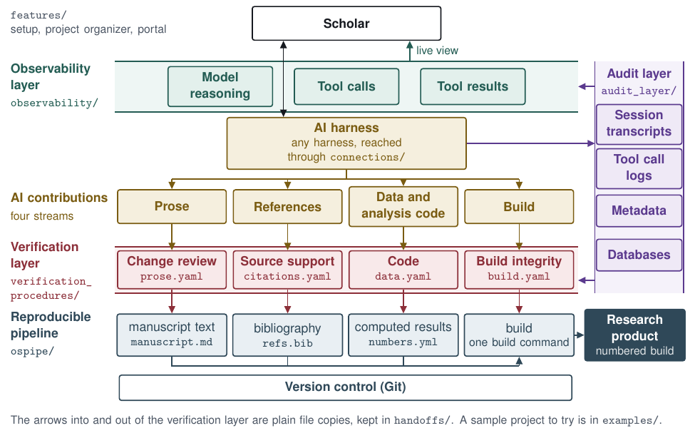

# Examples (`examples/`)

| Folder | What it is |
|---|---|
| [`sample_project/`](sample_project/README.md) | A small project with two research products, a one-page manuscript and a four-slide deck, built from one set of computed results. Start here to see the pipeline and the data check on a whole project |
| `test_story/` | The one synthetic test story every layer's tests come from, run end to end with `python3 -m pytest -q examples/test_story` |

[Back to the map](../README.md)
