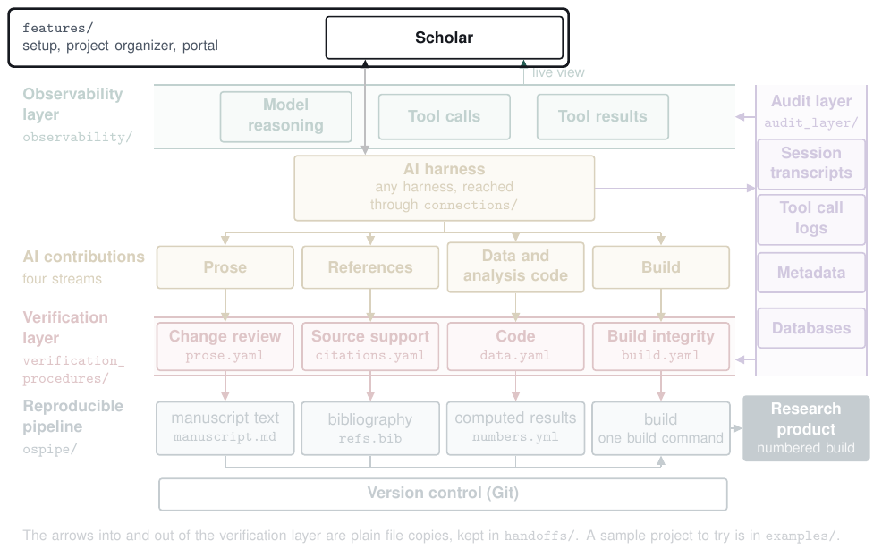

# Features (`features/`)

The features make the workflow easier to adopt and to learn. Pipeline setup records the scholar's software once and lays out a reproducible project. The project organizer proposes changes to a project's files, builds, and past sessions, applies them only when the scholar says so, and can undo each one. The portal is a static site for learning the workflow, setting it up, and writing a critique of any page.

| Read | For |
|---|---|
| [`setup/GUIDE.md`](setup/GUIDE.md) | `python3 -m features setup system`, then `setup project` for each project |
| [`organizer/GUIDE.md`](organizer/GUIDE.md) | The project organizer |
| [`CONTRACT.md`](CONTRACT.md) | Every command, including `portal build` |

Run its tests with `python3 -m pytest -q features/tests` from the repository's folder.

[Back to the map](../README.md)
