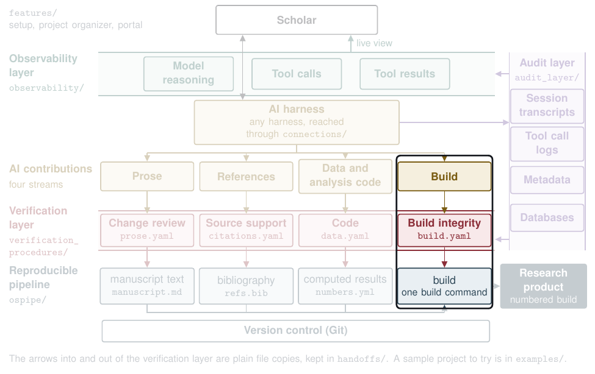

# Build



| | |
|---|---|
| **What the AI contributes** | Work on the build itself: the build file, the build folders, and results typed into the text |
| **What the check does** | Programs check that the build file (the Makefile) names one source per document, that every build on disk matches its row in the ledger, that a rebuild from each saved snapshot gives the same bytes, that results enter only through `{{num:key}}` placeholders, and that the audit record shows no AI writing into a build folder. No model is asked |
| **What the scholar decides** | Approve or hold each finding |
| **What lands in the pipeline** | The Makefile and the ledger `BUILDS.md`, and the results file the build reads, `verification/build.json` |

## Try it

From `verification_procedures/`:

```
python3 vg.py run graphs/build.yaml --run runs/try_build --inputs fixtures/build/seeded
python3 vg.py score --run runs/try_build --truth fixtures/build/seeded/truth.yaml
```

The score prints `{"faults": 7, "recall": 1.0, "missed": []} extras=0`, so all 7 planted faults were caught. The report is `runs/try_build/files/report.md`, and one of its blocking findings is an AI writing into a build folder:

> | blocking | check_ai_touch | builds/slides/v001.html | AI touched the deliverable directly; only the map's build rule may write here. | session s-0104, ai via Edit |

## See it on a real proposal

[The build report on the proposal](https://github.com/mro0001/verifiable-proposal-demo/blob/main/project/verification/proposal/build/report.md) finds one source for each document and no AI write to a build folder.

## Go deeper

- The steps, in order, with their pitfalls: [`graphs/build.yaml`](../../verification_procedures/graphs/build.yaml)
- What each step reads and writes: [`contracts/build.yaml`](../../verification_procedures/contracts/build.yaml)
- How a project's files reach the check: [`handoffs/project_to_build.py`](../../handoffs/README.md)
- How the build fills placeholders and numbers each build: [`ospipe/`](../../ospipe/README.md)
- Technical appendix, A2.5

[Back to the map](../../README.md)
