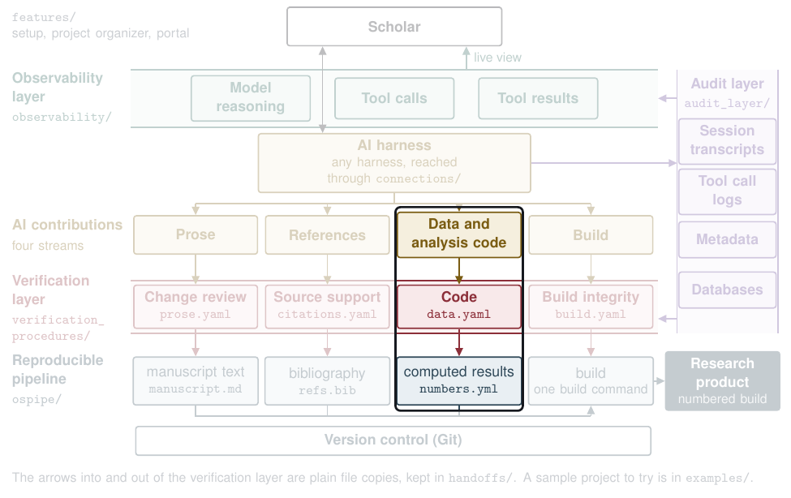

# Data and analysis code



| | |
|---|---|
| **What the AI contributes** | Analysis scripts, the parameters they read, and the numbers the text cites |
| **What the check does** | A program reruns the whole pipeline from the raw data in an empty folder and checks that every number in `numbers.yml` comes out the same. It also checks the raw data against its recorded checksum, finds settings typed into a script instead of read from `params.yaml`, and marks each script change and parameter the audit record shows the AI made, with the reason it gave. No model is asked |
| **What the scholar decides** | Approve or hold each number, each AI change to a script, and each parameter the AI set |
| **What lands in the pipeline** | `numbers.yml`, the file every placeholder in the text is filled from, and the results file the build reads, `verification/data.json` |

## Try it

From `verification_procedures/`:

```
python3 vg.py run graphs/data.yaml --run runs/try_data --inputs fixtures/data/seeded
python3 vg.py score --run runs/try_data --truth fixtures/data/seeded/truth.yaml
```

The score prints `{"faults": 9, "recall": 1.0, "missed": []} extras=2`, so all 9 planted faults were caught. The 2 extra findings follow from planted ones: the stale model record does not reproduce, and the hard-coded setting is never read from `params.yaml`. The report is `runs/try_data/files/report.md`, and one of its blocking findings is a number typed by hand:

> | blocking | check_numbers | slope_income_k | manuscript number does not come from the process | numbers.yml '0.015'; replayed table_model.csv estimate = '0.011' |

## Three more reports on the same stream

The data collection, cleaning, and analysis reports show each step a script carries out, with its exact code, and each sentence of the text that describes that phase, with the lines that carry it out or "missing". A model finds the sentences and the lines, and a program checks that each quote is in the text and each place is in a declared script.

```
python3 vg.py run graphs/data_cleaning.yaml --run runs/try_cleaning --inputs fixtures/data_phases/seeded --judge recorded:fixtures/data_phases/seeded/recorded_judge.json
python3 vg.py score --run runs/try_cleaning --truth fixtures/data_phases/seeded/truth.yaml
```

The score prints `{"faults": 2, "recall": 1.0, "missed": []} extras=0`. The planted faults of the phase reports are in the cleaning report, so that is the run to score.

## See it on a real proposal

[The final-numbers report on the appendix](https://github.com/mro0001/verifiable-proposal-demo/blob/main/project/verification/appendix/data/report.md) reruns the pipeline from the raw archives, and all 152 numbers agree with the rerun.

## Go deeper

- The steps, in order, with their pitfalls: [`graphs/data.yaml`](../../verification_procedures/graphs/data.yaml) and the three phase graphs beside it
- What each step reads and writes: [`contracts/data.yaml`](../../verification_procedures/contracts/data.yaml)
- How a project's files reach the check: [`handoffs/project_to_data.py` and `project_to_data_phases.py`](../../handoffs/README.md)
- A small project that follows the stream's conventions: [`examples/sample_project/`](../../examples/sample_project/README.md)
- Technical appendix, A2.5

[Back to the map](../../README.md)
