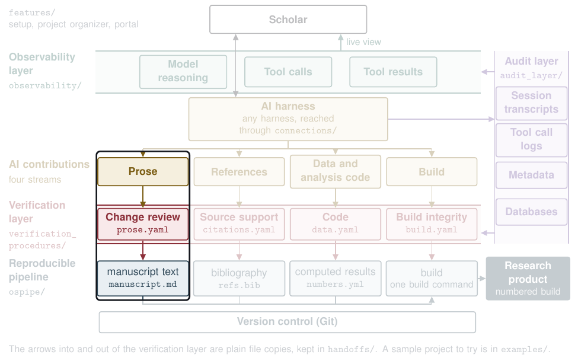

# Prose



| | |
|---|---|
| **What the AI contributes** | Changes to the text: edits, inserts, deletes, and moves |
| **What the check does** | A program compares the scholar's last draft with the final text, marks each change the audit record names as the AI's with the reason the AI gave, and flags each AI change with no recorded reason or one that alters a number, a citation, a quote, a negation, or a claim's strength. No model is asked |
| **What the scholar decides** | Approve or hold each AI change. The scholar's own changes are listed, not checked |
| **What lands in the pipeline** | `manuscript.md`, and the results file the build reads, `verification/prose.json` |

## Try it

From `verification_procedures/`:

```
python3 vg.py run graphs/prose.yaml --run runs/try_prose --inputs fixtures/prose/seeded
python3 vg.py score --run runs/try_prose --truth fixtures/prose/seeded/truth.yaml
```

The score prints `{"faults": 7, "recall": 1.0, "missed": []} extras=0`, so all 7 planted faults were caught. The report is `runs/try_prose/files/report.md`, and one of its entries is the AI changing a number:

> **c03 (edit)**
> - **Before:** We draw on personnel records from 48 agencies in three states [@alvarez2019].
> - **After:** We draw on personnel records from 52 agencies in three states [@alvarez2019].
> - **Stated reason:** Updated the agency count from 48 to 52 to match the sample table.
> - **Content changed:** numbers 48 -> 52, for the data stream

## See it on a real proposal

[The prose report on the proposal](https://github.com/mro0001/verifiable-proposal-demo/blob/main/project/verification/proposal/prose/report.md) lists 72 changes, all of them the AI's.

## Go deeper

- The steps, in order, with their pitfalls: [`graphs/prose.yaml`](../../verification_procedures/graphs/prose.yaml)
- What each step reads and writes: [`contracts/prose.yaml`](../../verification_procedures/contracts/prose.yaml)
- How a project's files reach the check: [`handoffs/project_to_prose.py`](../../handoffs/README.md)
- Technical appendix, A2.5

[Back to the map](../../README.md)
