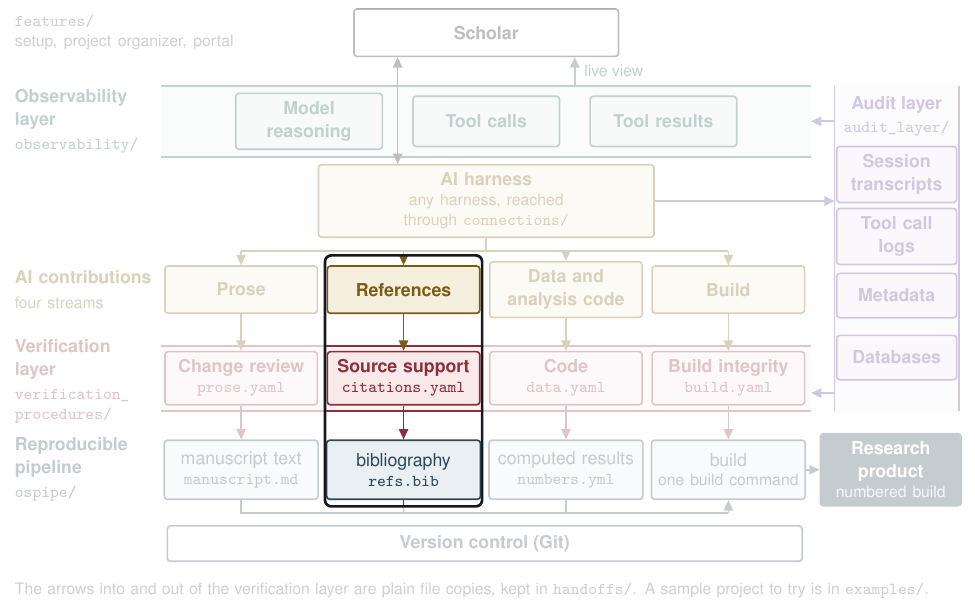

# References



| | |
|---|---|
| **What the AI contributes** | Citations: works it named, and the reason it gave for citing each |
| **What the check does** | Programs list each citation in the final text, read from the audit record who first named the work, look up its DOI, and check every quote word for word against the source text. One step asks a model, only to locate the passage a sentence draws on. It gives no verdict |
| **What the scholar decides** | Approve or hold each AI citation |
| **What lands in the pipeline** | `refs.bib`, and the results file the build reads, `verification/citations.json` |

## Try it

From `verification_procedures/`. Recorded answers stand in for the model, so nothing goes to the network:

```
VG_OFFLINE=1 python3 vg.py run graphs/citations.yaml --run runs/try_citations --inputs fixtures/citations/seeded --judge recorded:fixtures/citations/seeded/recorded_judge.json
python3 vg.py score --run runs/try_citations --truth fixtures/citations/seeded/truth.yaml
```

The score prints `{"faults": 13, "recall": 1.0, "missed": []} extras=0`, so all 13 planted faults were caught. The report is `runs/try_citations/files/report.md`, and one of its entries is a quote that is not in its source:

> **r05: @kessler2019**
> - **Sentence:** Programs that cut orientation to a single session saw retention fall [@kessler2019].
> - **Quote:** "Programs that cut orientation to a single session saw retention fall by 42% within a year." (located by recorded:recorded_judge.json, at p. 9)
> - **Quote check:** not found in source_kessler2019.txt, which holds the full text

## See it on a real proposal

[The references report on the proposal](https://github.com/mro0001/verifiable-proposal-demo/blob/main/verification/proposal/citations/report.md) lists 35 citations, 32 of them first named by an AI.

## Go deeper

- The steps, in order, with their pitfalls: [`graphs/citations.yaml`](../../verification_procedures/graphs/citations.yaml)
- What each step reads and writes: [`contracts/citations.yaml`](../../verification_procedures/contracts/citations.yaml)
- How a project's files reach the check: [`handoffs/project_to_references.py`](../../handoffs/README.md)
- The settings for DOI lookups (`VG_OFFLINE`, `VG_CROSSREF_URL`, `VG_DATACITE_URL`): [the main README](../../README.md#full-reference)
- Technical appendix, A2.5

[Back to the map](../../README.md)
