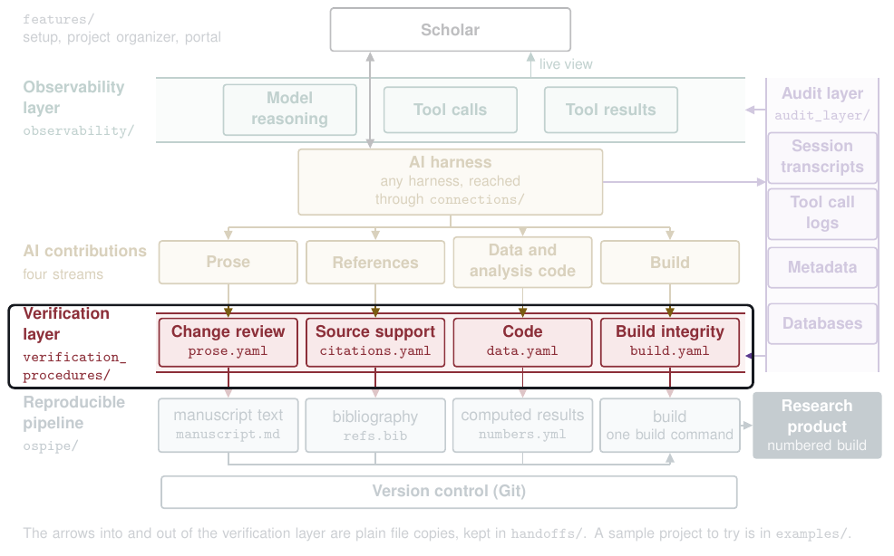

# Handoffs

Each handoff is a plain file copy from one layer's files to another's. They are kept here, in one place, so a scholar can replace each one when connecting the layers. No layer's code calls them. A scholar runs them by hand, and the end-to-end tests run them as commands.

These handoffs are the arrows into and out of the verification layer on the map. [Back to the map](../README.md).

A handoff only copies. It never converts, merges, or decides anything, and it never reads a record's content beyond what its row says.

| Script | Stream | Copies from (layer and path) | Copies to |
|---|---|---|---|
| `audit_to_project.py --record citation_log` | citations | Audit layer, the file `write-out citation-log --out FILE` wrote | `<project>/audit/citation_log.yaml` |
| `audit_to_project.py --record session_writes` | build | Audit layer, the file `write-out session-writes --project DIR --out FILE` wrote | `<project>/audit/session_writes.jsonl` |
| `audit_to_project.py --record rationales` | prose | Audit layer, the file `write-out rationales --project DIR --source FILE --out FILE` wrote | `<project>/audit/rationales.yaml` |
| `project_to_references.py` | citations | Pipeline, the filled-in text `vNNN.md` of the latest build in the product's ledger (`BUILDS.md` in `--builds-dir`, `builds/manuscript` by default) and the project's source text (`--source`, `manuscript.md` by default), the audit layer's citation provenance record, the file `write-out citation-provenance --out FILE` wrote (`--provenance`), and the references folder the scholar keeps (`refs.yaml`, `metadata_cache.json`, every `source_*.txt`) | A new inputs folder (`--to`) for the references procedure, with the latest build's text as `draft.md`, the record as `citation_provenance.yaml`, and the source text under its own name so the run lists its checksum |
| `project_to_build.py` | build | Pipeline, the whole project folder (every regular file but `.git`), its `audit/session_writes.jsonl`, and each source text (`--source`, repeatable, `manuscript.md` by default) | A new inputs folder (`--to`) for the build procedure, holding `project.tar`, `session_writes.jsonl`, and each source text under its own name |
| `project_to_data.py` | data | Pipeline, every regular file at the top level of the project, which must hold `pipeline.yaml`, `acquisition.yaml`, `params.yaml`, and `numbers.yml`, and from its subfolders only each script and helper `pipeline.yaml` names, and the audit layer's record of the AI's file edits, the file `write-out file-edits --project DIR --out FILE` wrote (`--file-edits`, optional) | A new inputs folder (`--to`) for the data procedure, holding those files at their paths inside the project and the record as `file_edits.yaml` |
| `project_to_data_phases.py` | data, the three phase reports | Pipeline, the project's `pipeline.yaml`, each script and helper it names, and the filled-in text `vNNN.md` of the latest build in the product's ledger (`BUILDS.md` in `--builds-dir`, `builds/manuscript` by default, given once for each product whose texts are joined) | A new inputs folder (`--to`) for the data collection, cleaning, and analysis reports, holding the scripts at their paths and the text as `final_text.md` |
| `project_to_prose.py` | prose | Pipeline, the project's `author_draft.md`, its source text (`--source`, `manuscript.md` by default), and `audit/rationales.yaml`, and the prose folder the scholar keeps (`versions.yaml`) | A new inputs folder (`--to`) for the prose procedure, with the author draft as `baseline.md`, the source text as `revised.md`, and the rationales as `rationales.yaml` |
| `results_to_pipeline.py` | prose, citations, data, or build (`--stream`) | Verification, a run's `results.json` with the scholar's decisions | `<project>/verification/<stream>.json`, which the build reads, or with `--product NAME` `<project>/verification/<product>/<stream>.json`, the folder a build file with several products reads for that product, made when absent |
| `graphs_to_kb.py` | none, the knowledge base | Verification, the procedures folder's `graphs/`, `contracts/`, and `registry.yaml` (`--procedures`, normally `verification_procedures`) | A new folder (`--to`) holding those three, which `python3 -m audit_layer.kb graph-entries --procedures DIR` reads |
| `kb_export_to_server.py` | none, the knowledge base | Audit layer, the file `python3 -m audit_layer.kb export --out FILE` wrote (`--export`) | The file (`--to`) that the knowledge base server's `--index FILE` names in `python3 -m connections serve kb --index FILE` |
| `writeout_to_project.py` | none, the project's record | Audit layer, the folder `write-out project --project DIR --out DIR` wrote, which holds `written_out.yaml` (`--from`) | A new or empty folder inside the project (`--to`), such as `<project>/records`, holding the whole folder |
| `session_index_to_project.py` | none, the project's public record | Audit layer, the folder `write-out session-index --project DIR --out DIR` wrote, which holds `sessions.csv` (`--from`) | `<project>/sessions/`, holding the whole folder and replacing an older copy |

`audit_to_project.py` prints the file it wrote, `project_to_references.py`, `project_to_build.py`, `project_to_data.py`, `project_to_data_phases.py`, and `project_to_prose.py` print the inputs folder, `results_to_pipeline.py` and `kb_export_to_server.py` print the file they wrote, and `graphs_to_kb.py`, `writeout_to_project.py`, and `session_index_to_project.py` print the folder they wrote. `vg.py decide` writes each decision into the run's own results file, so run `results_to_pipeline.py` again after deciding. `project_to_build.py` packs the archive in sorted order with times 0, mode 0644, and owner 0, so the same project always packs to the same bytes, and it packs ignored files too, unlike `git archive`. A refusal exits 2 with a message naming the problem and writes nothing.

`kb_export_to_server.py` replaces an older copy, as `audit_to_project.py` does, so a new export reaches the server on its next call. `writeout_to_project.py` copies into a folder of its own so the records never overwrite or mix with the project's own files. `session_index_to_project.py` replaces an older copy whole, so a page of a session the new index no longer lists is not left behind, and it refuses a `sessions/` folder that holds files but no `sessions.csv`, since that folder is the project's own and not an older copy. The pipeline reads only the three records in `audit/` that `audit_to_project.py` copies.

## Connection points

Beside the copies above, a layer reads another layer's files in place, read only, at a path given on its command line or in its settings. No layer writes another layer's files. Each read below is one place where a scholar can put a copy here instead, by pointing the option or setting at a folder or file a new handoff writes.

| Reading layer and command | Option or setting that names the path | The other layer's files it reads |
|---|---|---|
| Observability, `python3 -m observability build` and `watch` | `--audit-home DIR` | Audit layer, `audit.sqlite` opened read only (its `sessions`, `events`, and `transcripts` tables) and the transcript files in `files/` |
| Observability, `build` and `watch` | `--vg-runs PATH...` | Verification, each run folder's `manifest.json`, `trail.jsonl`, `records/`, `prompts/`, and `responses/` |
| Observability, `build` and `watch` | `--kb-dir DIR` | The knowledge base's entry files, normally `audit_layer/kb/corpus/` |
| Audit layer, `python3 -m audit_layer knowledge sync` | `--corpus DIR` | The knowledge base's entry files, normally `audit_layer/kb/corpus/` |
| Audit layer, `python3 -m audit_layer.kb graph-entries` | `--procedures DIR` | Verification, `graphs/`, `contracts/`, and `registry.yaml`, or the copy `graphs_to_kb.py` writes |
| Audit layer, `python3 -m audit_layer.kb source-check` | `--root DIR` | The file each entry names as its source, which for a procedure entry is its graph in `verification_procedures/graphs/` |
| Audit layer, `capture --harness wrappers`, `sweep`, and `check-captures` | `CONNECTIONS_HOME`, else `~/.workflow_connections`, or `--root wrappers=PATH` and capture's own file paths | Connections, the event files in `events/` of the connections home |
| Audit layer, `tag --answers live` | `CONNECTIONS_HOME`, else `~/.workflow_connections` | Connections, the provider setting `provider.yaml` |
| Verification, `vg.py run` with `--judge live` or `--second live` | `CONNECTIONS_HOME`, else `~/.workflow_connections` | Connections, the provider setting `provider.yaml` |
| Connections, `python3 -m connections serve audit` | `--home DIR`, else `AUDIT_HOME`, else `~/.audit_layer` | Audit layer, `audit.sqlite` opened read only |
| Connections, `serve kb` | `--index FILE` | Audit layer, the `kb-index` export, or the copy `kb_export_to_server.py` writes. Each call runs `verification_procedures/vg.py` on `graphs/mcp_kb.yaml`, found from the server's own place in the repository, as a command |
| Connections, `trigger hook` and `trigger make` | `registry` in `triggers.yaml` in the connections home, else `verification_procedures/registry.yaml` found from the code's own place | Verification, the registry's procedure ids, graphs, and `triggers.files` patterns |
| Connections, `wrap`, `serve events`, `trigger hook`, and `trigger make` | `AUDIT_HOME`, else `~/.audit_layer` | Audit layer, `excluded_folders` in `settings.yaml` |
| Connections, `trigger make` | `--project DIR`, `--source FILE`, and `--numbers FILE` | Pipeline, the project's `verification/<stream>.json`, source text, and numbers file |
| Connections, `adapt word` | `--builds-dir DIR` | Pipeline, the build ledger `BUILDS.md` in the project's builds folder |
| Verification, `python3 -m review reconcile` | `--builds-dir DIR` | Pipeline, the build ledger and the baseline and revision snapshots in the project's builds folder |
| Features, `python3 -m features setup system` | `--audit-home DIR`, else `AUDIT_HOME`, else `~/.audit_layer` | Audit layer, only whether `settings.yaml` exists in the audit home, to know whether to run `python3 -m audit_layer init` as a command |
| Features, `setup project` | `workflow_root` in `system.yaml` in the features home (`--home DIR`, else `FEATURES_HOME`, else `~/.workflow_features`) | The knowledge base entry `procedures-ops-github` in `audit_layer/kb/corpus/`, for the GitHub procedure's run command |
| Features, `organize scan`, `check`, `apply`, and `undo` | `audit_home` in `system.yaml` in the features home (`--home DIR`, else `FEATURES_HOME`, else `~/.workflow_features`) | Audit layer, `audit.sqlite` opened read only (its `sessions` and `events` tables only, never `transcripts` or the file store) |
| Features, `organize scan`, `check`, `apply`, and `undo` | The project folder `DIR`, with each product's builds folder as `ospipe products --json` names it | Pipeline, each product's build ledger `BUILDS.md` and the build files its rows name |
| Features, `portal build` | `kb_corpus` in the portal's config (`--config FILE`, else `features/portal/portal.yaml`), normally `audit_layer/kb/corpus` | The knowledge base's entry files, each `<group>/<id>.md` |
| Features, `portal build` | `graphs` in the portal's config, normally `verification_procedures/graphs` | Verification, each graph `*.yaml`, the contracts file each graph names, and whether each step's file in `implementations/` exists |
| Features, `portal build` | `docs` in the portal's config | Other layers' guides, `verification_procedures/README.md`, `verification_procedures/AUTHORING.md`, `examples/sample_project/README.md`, `audit_layer/hooks/INSTALL.md`, `observability/CONTRACT.md`, `handoffs/README.md`, and `connections/README.md` |

Run the tests from the repository root with `python3 -m pytest -q handoffs/tests`.
