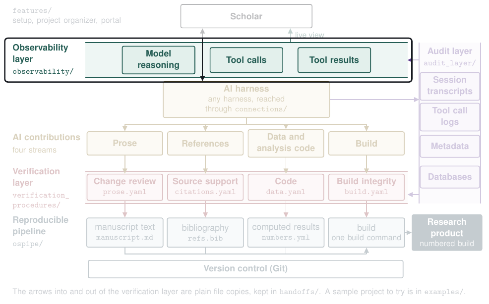

# The observability layer (`observability/`)

The observability layer lets the scholar watch AI work as it happens, including the work of subagents, AI programs outside the harness, and the knowledge base entries the AI reads. It reads the audit layer's record, writes each session or run as a trace file, and shows them in a dashboard that opens from disk with no server.

| Read | For |
|---|---|
| `python3 -m observability build` and `watch` | Build the view once, or keep it live as the record changes |
| [`CONTRACT.md`](CONTRACT.md) | What the layer reads and writes, and what may change |

Run its tests with `python3 -m pytest -q observability/tests` from the repository's folder.

[Back to the map](../README.md)
