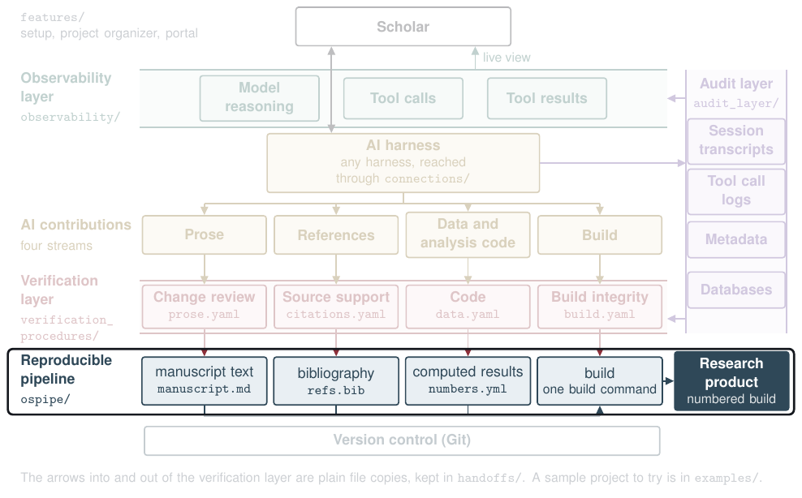

# The reproducible pipeline (`ospipe/`)

The pipeline builds each research product from plain-text files. It fills every `{{num:key}}` placeholder in the text from the project's numbers file, stops if any placeholder has no value, and writes the next numbered build with a row in the ledger `BUILDS.md`. It makes no model or network calls.

| Read | For |
|---|---|
| [`CONTRACT.md`](CONTRACT.md) | What the pipeline promises and what may change |
| [`MODULES.md`](MODULES.md) | One line for each module, with its own contract |
| [`../examples/sample_project/`](../examples/sample_project/README.md) | A manuscript and slides built from one numbers file |

Run its tests with `(cd ospipe && python3 -m pytest -q)`.

[Back to the map](../README.md)
